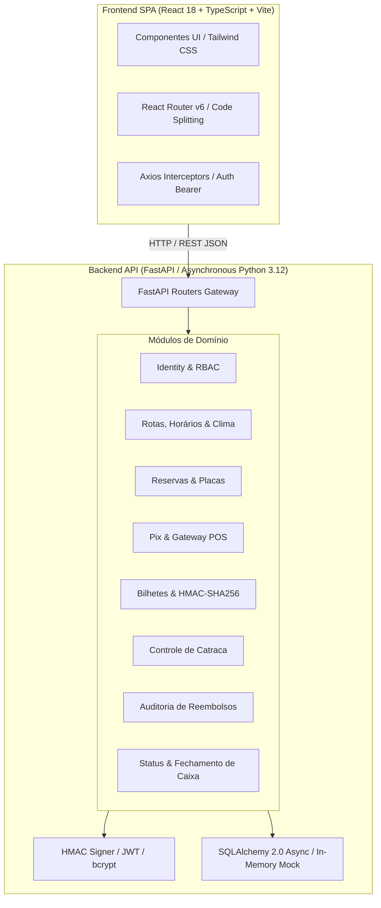

# 🚢 Projeto Jovem Protagonista — TTNB Ferry Booking System

<div align="center">


-success?style=for-the-badge&logo=pytest&logoColor=white)


<p align="center">
  <strong>Plataforma integral de bilhetagem eletrônica, controle de catracas marítimas e gestão de travessias para o Terminal Náutico da Bahia (TTNB).</strong>
</p>

<p align="center">
  <em>Conectando Salvador ⇄ Mar Grande (Ilha de Itaparica) e Salvador ⇄ Morro de São Paulo com alta performance, design moderno e segurança criptográfica.</em>
</p>

[Visão Geral](#-visão-geral) • [Destaques de Engenharia](#-destaques-de-engenharia) • [Arquitetura](#-arquitetura-do-sistema) • [Módulos & Funcionalidades](#-módulos--funcionalidades) • [Como Executar](#-como-executar) • [Testes Automatizados](#-testes-automatizados)

</div>

---

## 🌊 Visão Geral

O **Terminal Náutico da Bahia (TTNB)** é o principal portal marítimo da Baía de Todos-os-Santos. Este sistema moderniza a jornada de travessia marítima através de:
- **Compra de Passagens em < 1 minuto** (via Pix Instantâneo ou Cartão de Crédito).
- **Bilhete Digital com QR Code Anti-Fraude** assinado via **HMAC-SHA256**.
- **Validação de Embarque Ágil em Catracas** (via câmera com `BarcodeDetector` nativo ou código alfanumérico).
- **Filômetro e Previsão Marítima em Tempo Real** integrados a regras da Capitania dos Portos e Agerba.
- **Operação de Guichê Presencial (POS)** com fechamento de caixa automatizado e exportação de relatórios em CSV.
- **Gestão Financeira e Estornos Auditáveis** com segregação estrita de funções (sem auto-aprovação).

---

## ⚡ Destaques de Engenharia & Performance

| Pilar | Destaque Técnico | Benefício Real |
| :--- | :--- | :--- |
| **Performance Frontend** | *Route-based Code Splitting* com `React.lazy` + `Suspense` e divisão de vendors em chunks | **Redução de 91,5%** no bundle inicial (de 425 kB para **35,8 kB** gzipped ~9,5 kB). |
| **Segurança & Anti-Fraude** | Assinatura digital dos bilhetes com chave secreta simétrica `HMAC-SHA256` | Impede falsificação ou adulteração de parâmetros de bilhete em trânsito. |
| **Ergonomia & Mobile** | Safe-area insets (`.pb-safe`), targets mínimos de toque **44x44px** e trava de rolagem horizontal | Experiência fluida em iPhones e celulares Android no cais. |
| **Pagamento 3D Interativo** | Cartão de crédito virtual 3D com rotação de 180° (*flip card*), detecção dinâmica de bandeira e **algoritmo de Luhn** | Feedback visual instantâneo para o passageiro antes do envio da transação. |
| **Backend sem Gambiarras** | Execução em **Python 3.12.8 nativo** sem shims ou mocks no código de produção (`_DummyGreenlet` removido) | Máxima estabilidade, sem conflitos de DLLs e 100% alinhado às boas práticas da PEP 517/518. |
| **Acessibilidade Inclusiva** | Conformidade com **WCAG 2.1 AA**, link de salto para teclado (`#conteudo`) e anéis `:focus-visible` | Navegação acessível para leitores de tela e comandos de teclado. |

---

## 🏛 Arquitetura do Sistema

O projeto adota uma arquitetura em **Monólito Modular Limpo** (*Modular Monolith*), combinando facilidade de implantação com alto desacoplamento funcional entre domínios de negócio:



---

## 📱 Módulos & Funcionalidades

### 1. 🎫 Área do Passageiro & Compra Online
- **Catálogo de Horários**: Visualização de viagens para Mar Grande e Morro de São Paulo com indicação de lotação, atrasos e preços.
- **Inclusão de Veículos**: Reserva de vagas para automóveis e motos, com exigência da placa (Mercosul ou antiga).
- **Edição de Placa com Auditoria**: O passageiro pode alterar a placa do veículo até o momento do embarque. Cada alteração registra data, responsável e motivo no histórico auditável.
- **Checkout Seguro**: Escolha entre Pix Instantâneo (com QR Code SVG e chave copia-e-cola de 15 minutos) ou Cartão de Crédito.
- **Emissão e Reenvio de Bilhete**: Geração de cartão de embarque digital com opção de impressão fiscal e reenvio por e-mail.

### 2. 🛡️ Controle de Catraca & Fiscal de Cais (`/operador/embarque`)
- **Scanner Óptico de Câmera**: Reconhecimento em tempo real via API nativa `BarcodeDetector`.
- **Validação de Assinatura Digital**: Verificação matemática de autenticidade sem consultar serviços lentos.
- **Bloqueio de Reutilização**: Uma vez validado, qualquer tentativa posterior de embarque com o mesmo bilhete é recusada com registro do primeiro uso.
- **Histórico da Catraca**: Visualização em tempo real das últimas validações ocorridas no terminal.

### 3. 💼 Guichê Presencial & Fechamento de Caixa (`/operador/caixa`)
- **Emissão Rápida POS**: Venda de passagens de balcão com baixa em Dinheiro, Cartão ou Pix.
- **Balanço do Turno**: Métricas consolidadas em tempo real de dinheiro físico na gaveta, faturamento digital e total de bilhetes emitidos.
- **Exportação CSV**: Download do relatório fiscal completo para prestação de contas à Agerba e operadoras marítimas.

### 4. ⚖️ Gestão Financeira & Reembolsos (`/admin/reembolsos`)
- **Segregação de Funções**: Operador solicita o estorno → Administrador avalia e aprova com justificativa → Operador de caixa efetiva a devolução em espécie ou Pix.
- **Proteção de Caixa**: Impede auto-aprovações e garante que nenhuma devolução ocorra sem registro formal.

### 5. 🌊 Monitoramento Operacional & Filômetro (`/status` e `/filometro`)
- **Filômetro Digital**: Indicador do tempo estimado de espera e percentual de ocupação das salas de embarque.
- **Boletim Meteorológico Marítimo**: Temperatura, velocidade do vento em nós, condição da maré e visibilidade na Baía.
- **Cancelamento Inteligente**: Em caso de mau tempo decretado pela Capitania dos Portos, viagens são suspensas com garantia automática de remarcação ou estorno integral.

---

## 📁 Estrutura de Diretórios

```
Projeto_Jovem_Protagonista_Antigravity/
├── backend/
│   ├── alembic/                # Versionamento de schema PostgreSQL (22 tabelas)
│   ├── app/
│   │   ├── core/               # Configurações Pydantic, banco assíncrono e segurança HMAC/JWT
│   │   ├── modules/
│   │   │   ├── identity/       # Autenticação, usuários, papéis e perfis
│   │   │   ├── public/         # Rotas públicas (horários, status, clima)
│   │   │   ├── bookings/       # Ciclo de reservas e histórico de placas de veículos
│   │   │   ├── payments/       # Sessões Pix, cartão e guichê presencial
│   │   │   ├── tickets/        # Bilhetes com assinatura criptográfica HMAC-SHA256
│   │   │   ├── boarding/       # Catraca, validação de QR Code e logs operacionais
│   │   │   ├── refunds/        # Ciclo de reembolsos com aprovação administrativa
│   │   │   └── operations/     # Filômetro, balanço de caixa e boletins meteorológicos
│   │   └── main.py             # Instância FastAPI limpa (sem shims), CORS e documentação
│   ├── tests/                  # Suíte de testes unitários e de integração
│   └── pyproject.toml          # Dependências declarativas e empacotamento PEP 517/518
│
├── frontend/
│   ├── src/
│   │   ├── components/         # Navbar acessível, Drawer 01-08, PageSkeleton, Toast
│   │   ├── pages/              # 16 telas implementadas para todos os fluxos da plataforma
│   │   ├── services/           # Cliente Axios configurado com interceptores
│   │   ├── utils/              # Armazenamento seguro e helpers
│   │   ├── App.tsx             # Roteador com Code Splitting (React.lazy)
│   │   └── main.tsx            # Ponto de entrada da SPA
│   ├── tailwind.config.js      # Paleta oficial TTNB e extensões utilitárias
│   ├── vite.config.ts          # Configuração de build e divisão de chunks de vendor
│   └── package.json
│
└── README.md
```

---

## 🛠️ Como Executar

### Pré-requisitos
- **Python 3.12+** instalado.
- **Node.js 18+** e **npm** instalados.
- **Git** instalado.

---

### 1. Clonar o Repositório

```bash
git clone https://github.com/joao524/projeto-jovem-protagonista.git
cd projeto-jovem-protagonista
```

---

### 2. Configurar e Iniciar o Backend

```bash
# Entrar na pasta do backend
cd backend

# Criar e ativar o ambiente virtual (.venv)
python -m venv .venv

# Windows (PowerShell):
.\.venv\Scripts\Activate.ps1
# Linux / macOS:
# source .venv/bin/activate

# Atualizar o pip e instalar as dependências
python -m pip install --upgrade pip
python -m pip install -e .

# Iniciar o servidor de desenvolvimento
python -m uvicorn app.main:app --host 127.0.0.1 --port 8000 --reload
```

- **Healthcheck:** `http://127.0.0.1:8000/health`
- **Documentação Interativa Swagger:** `http://127.0.0.1:8000/docs`
- **Documentação ReDoc:** `http://127.0.0.1:8000/redoc`

> [!NOTE]
> O backend opera por padrão em **modo de demonstração autônomo** (*In-Memory Store*), permitindo testar todos os fluxos de reserva, pagamento, catraca e fechamento de caixa imediatamente, sem necessidade de configurar um servidor PostgreSQL local prévio.

---

### 3. Configurar e Iniciar o Frontend

Em um novo terminal:

```bash
# Entrar na pasta do frontend
cd frontend

# Instalar dependências
npm install

# Iniciar o servidor Vite
npm run dev -- --host 0.0.0.0 --port 3000
```

- **Aplicação Web:** `http://localhost:3000`

---

## 🧪 Testes Automatizados

O backend possui uma suíte rigorosa de testes de integração e testes unitários cobrindo todos os fluxos de ponta a ponta:

```bash
# Com o .venv ativado e dentro da raiz do projeto:
$env:PYTHONPATH="backend"
.\.venv\Scripts\python.exe -m pytest backend/tests -v
```

### Resultados da Suíte de Testes (100% Green):

| Teste | Escopo | Resultado |
| :--- | :--- | :---: |
| `test_public_endpoints` | Consulta pública de rotas, saídas, filômetro e clima marítimo | **PASSED** |
| `test_complete_booking_payment_and_boarding_cycle` | Ciclo completo: Criação de reserva ➔ Pix ➔ Confirmação ➔ Catraca QR Code | **PASSED** |
| `test_vehicle_plate_editing_and_audit_rules` | Regras de edição de placa: Formato Mercosul, RBAC do titular, auditoria e bloqueio pós-embarque | **PASSED** |
| `test_payment_gateway_webhook_lifecycle_and_idempotency` | Webhooks de pagamento com idempotência e proteção contra chamadas duplicadas | **PASSED** |
| `test_notification_service_and_email_preview` | Emissão de comprovante e reenvio de confirmação de bilhete | **PASSED** |
| `test_cash_register_and_csv_report_export` | Baixa de guichê POS, somatório de gaveta e exportação de CSV fiscal | **PASSED** |
| `test_weather_suspension_lifecycle` | Suspensão de travessia por aviso meteorológico e liberação de reembolso sem custos | **PASSED** |
| `test_password_hashing` | Criptografia forte de credenciais de usuários com bcrypt | **PASSED** |
| `test_ticket_signature_and_anti_tampering` | Assinatura HMAC-SHA256 de bilhetes e bloqueio de adulteração maliciosa | **PASSED** |

---

## 🎨 Paleta de Cores e Identidade Visual

As cores da interface foram calibradas diretamente a partir do padrão visual do Terminal Náutico da Bahia:

| Cor | Hex | Aplicação Principal |
| :--- | :--- | :--- |
| **TTNB Navy** | `#07395c` | Cor primária, cabeçalhos náuticos, títulos e identidade institucional. |
| **TTNB Orange** | `#ed7837` | Cor de destaque (*call-to-action*), botões de compra e confirmação. |
| **TTNB Teal** | `#318a91` | Cor secundária, links ativos, badges de status marítimo e focos acessíveis. |
| **TTNB Mint** | `#ecf5f0` | Tons de apoio, superfícies de status operacional regular e sucesso. |
| **Off-White Canvas** | `#fffefa` | Fundo principal da aplicação, garantindo leitura suave e descanso visual. |

---

## 📄 Licença

Este projeto foi desenvolvido como parte de iniciativa de modernização portuária e mobilidade marítima para o **Terminal Náutico da Bahia**. Distribuído sob a licença **MIT**.
